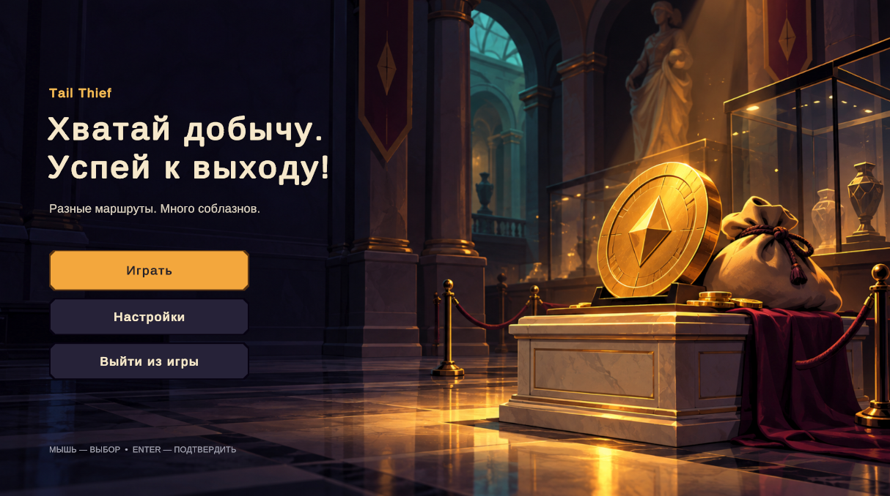

# Tail Thief

> **Оттяни, отпусти, укради.**

Игра для геймджема **FunFlow × ТПУ**. Вор-бобёр пробирается через ночной музей и собирает добычу в мешок. До выхода он должен добраться, пока его не поймали.



> **Обязательно дойдите до третьего уровня** - он самый интересный!

## Как запустить

### В редакторе Unity

1. Установите **Unity 6000.6.5f1** (Unity 6.6) через Unity Hub.
2. Клонируйте репозиторий и откройте папку проекта в Unity Hub (**Add → Add project from disk**).
3. При первом открытии Unity сама откроет главную сцену `Assets/Game/Core/Scenes/Game.unity`. Если этого не случилось, откройте её через меню **FunFlow → Open Main Scene** или сочетанием `Ctrl+Shift+M`.
4. Нажмите **Play**.

> Перед игрой кликните по окну **Game**, чтобы клавиши работали.

### Готовая сборка

Собранная игра лежит в папке [`dist/`](dist/). Распакуйте архив и запустите `.exe`.

## Управление

| Действие | Как |
|---|---|
| Прицелиться | Зажмите левую кнопку мыши на воре и тяните **назад** |
| Запуск | Отпустите кнопку: чем сильнее оттянули, тем дальше полетит вор |
| Предпросмотр | Пунктир на полу показывает, куда доедет вор |
| Рестарт / дальше | Кнопки на экране результата |

Новый запуск возможен, только когда вор остановился.

## Правила

- **Добыча.** Монеты и экспонаты попадают в мешок и увеличивают счёт.
- **Тяжесть.** Чем полнее мешок, тем медленнее и короче скольжение. Вор при этом всё равно продвигается вперёд.
- **Ловушки-лезвия.** Режут мешок, и часть добычи теряется.
- **Сигнальные плиты.** Включают тревогу на **60 секунд**. Не успели к выходу за это время — попались.
- **Охранник.** Видит вора в пределах своего конуса обзора. Обходите его со спины.
- **Выход.** Бирюзовая дверь в конце зала. Дошли до неё — уровень пройден.
- В игре **3 уровня**, каждый следующий сложнее.

## Структура репозитория

```
Assets/Game/
├── Core/          # состояние забега, контракты (Contracts), общий конфиг (Config), главная сцена
├── Player/        # вор: запуск, предпросмотр, столкновения, мешок, модель
├── Loot/          # добыча, вес, мешок
├── Level/         # уровни, ловушки, тревога, охранник, выход
└── Presentation/  # HUD, экраны, звук, музыка, эффекты
dist/              # готовая сборка игры
docs/              # документация (team-guide.md — правила командной работы)
```

Модули общаются друг с другом только через интерфейсы из `Core/Contracts`: `IRunSession`, `ILootInventory`, `IPlayerControl` и другие. Числа для баланса собраны в `Core/Config`.

## Тесты

**Window → General → Test Runner**. Запустите все тесты на вкладках **EditMode** и **PlayMode**.
Тесты проверяют подбор и стоимость добычи, тяжесть, порез мешка, тревогу, победу и поражение.

## Технологии

Unity 6000.6.5f1, URP 17, Input System, TextMesh Pro, Unity Test Framework. Модели сделаны в Blender.

## Команда

| № | Роль | Участник |
|---|---|---|
| 1 | Ядро, сцена, сборка | Воронин Вадим |
| 2 | Персонаж и запуск, модели | Демченко Владислав |
| 3 | Добыча и мешок, музыка | Белобородов Арсений |
| 4 | Уровни, ловушки, охранник | Захидов Артём |
| 5 | Интерфейс, звук, эффекты | Кравченко Мария |